<a id="top"></a>

<div align="center">

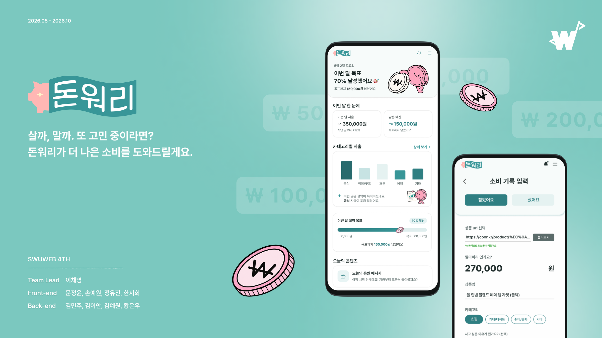

# DonWorry · 돈워리

### 사기 전 한 번 더, 참은 소비도 가치 있게.

구매 전 질문과 고민 시간으로 충동적인 결정을 늦추고,<br />
소비한 순간과 참아낸 순간을 함께 돌아보는 모바일 웹앱

[](https://don-worry-fe.vercel.app)


**[프로젝트 소개](#overview) · [주요 화면](#features) · [기술과 설계](#engineering) · [로컬 실행](#getting-started) · [팀](#team)**

<sub>SWUWEB 4th · Frontend · 모바일 기준 최대 너비 390px</sub>

</div>

<br />

<a id="overview"></a>

## 결제 직전의 망설임에서 시작한 서비스

계획적으로 소비하고 싶어도 구매하는 순간에는 감정과 충동에 흔들리기 쉽습니다. 돈워리는 **구매 전에 한 번 더 생각할 시간**을 만들고, **사지 않은 선택도 기록**해 자신의 소비 기준을 찾아가도록 돕습니다.

| 우리가 발견한 문제                   | 서비스의 접근                               | 연결한 기능         |
| :----------------------------------- | :------------------------------------------ | :------------------ |
| 계획보다 순간의 감정이 앞서요        | 구매 이유를 질문으로 돌아보기               | 구매 전 개입        |
| 지금 사도 괜찮은지 모르겠어요        | 소비 위험도와 필요한 근로 시간 확인하기     | 위험도 안내         |
| 미뤄둔 소비를 다시 판단하기 어려워요 | 고민 시간을 정하고, 시간이 지난 뒤 선택하기 | 위시리스트와 재판단 |
| 쓰지 않은 돈은 눈에 잘 보이지 않아요 | 실제 지출과 참은 소비를 함께 살펴보기       | 소비 기록과 리포트  |

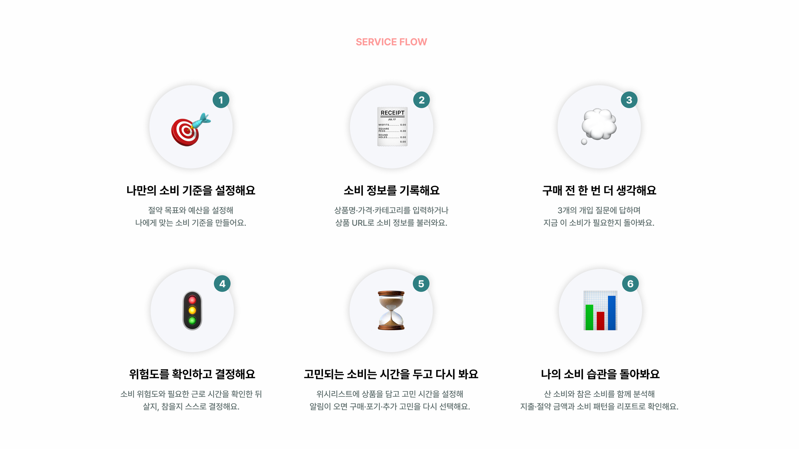

<details>
<summary><strong>기획 배경 · 리서치 · 페르소나</strong></summary>

기획 과정에서 참고한 소비 조사와 구매 의사 실험을 바탕으로, 감정·판단 기준·시간이라는 세 가지 관점에서 가설을 세웠습니다. 조사별 출처와 수치는 아래 기획 자료에 담았습니다.

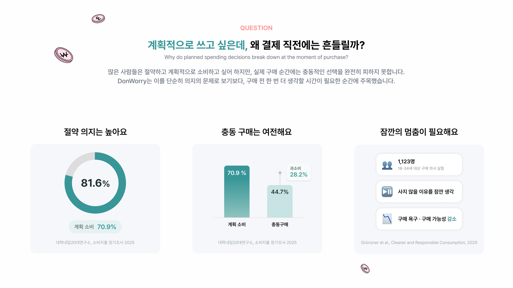

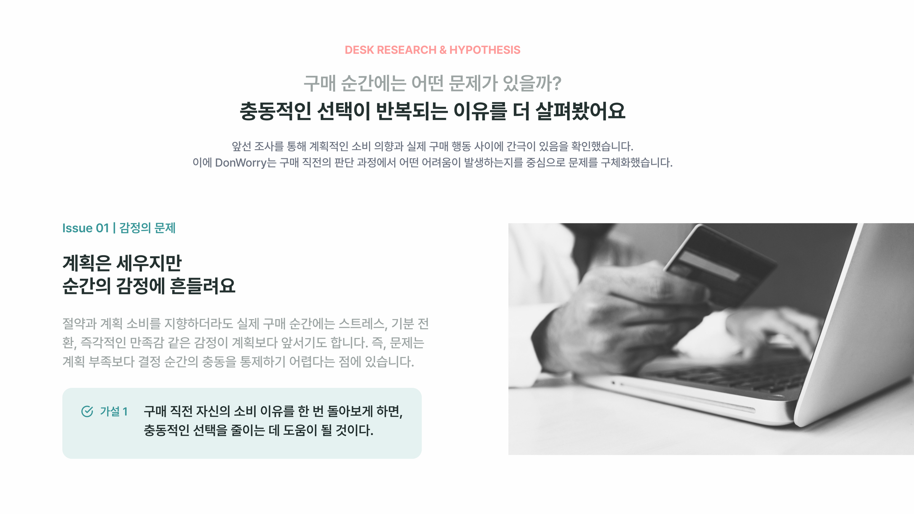

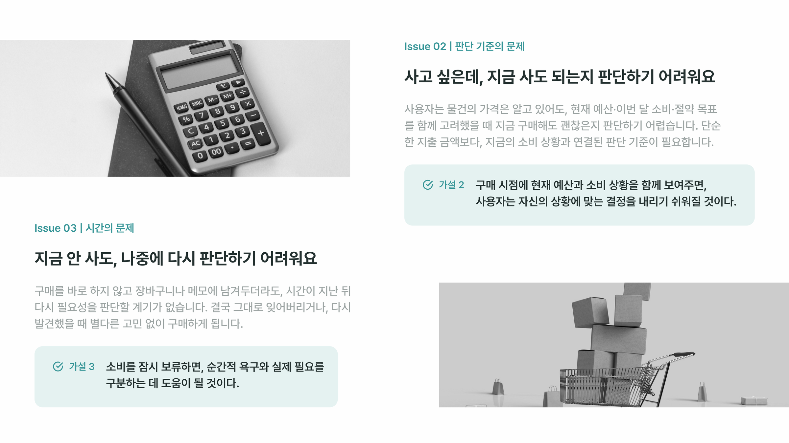

### 페르소나

**김서연 (25) · 충동소비형 사회초년생**과 **박지우 (28) · 계획소비형 직장인**을 가상의 사용자로 설정했습니다. 두 사용자의 필요와 불편, 소비 행동과 목표를 기능 구체화·정보 구조·화면 설계의 의사결정 기준으로 활용했습니다.

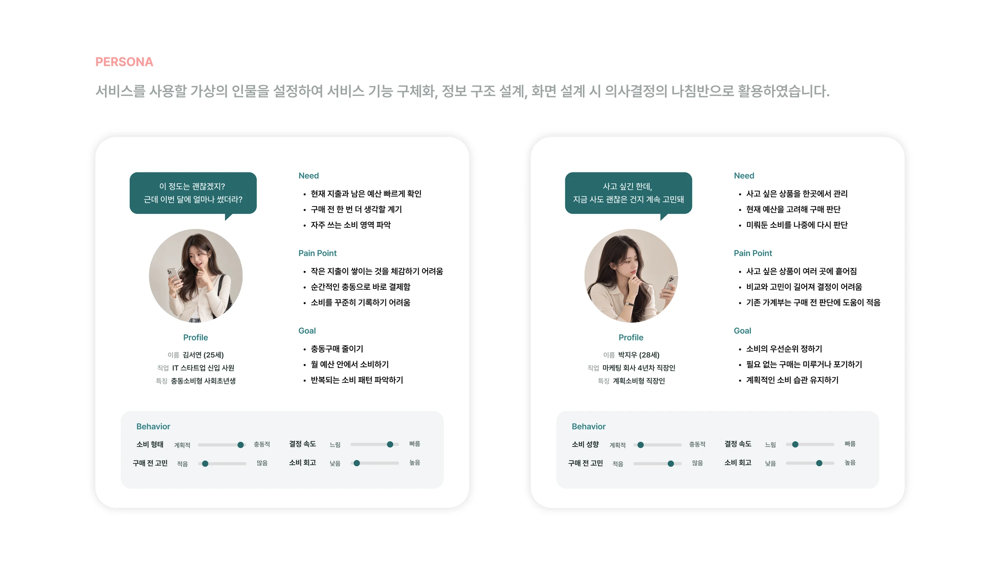

</details>

<br />

<a id="features"></a>

## 구매 전부터 돌아보기까지

> 아래 이미지는 서비스 화면과 사용자 흐름을 정리한 소개 자료입니다.

### 01 · 구매 전, 세 번의 질문으로 잠깐 멈추기

소비 이유를 돌아보는 질문에 답하고 충동소비 위험도를 확인합니다. 시급을 설정했다면 상품 가격을 **필요한 근로 시간**으로도 보여주며, 위험도에 따라 잠시 기다린 뒤 최종 선택으로 이어집니다.

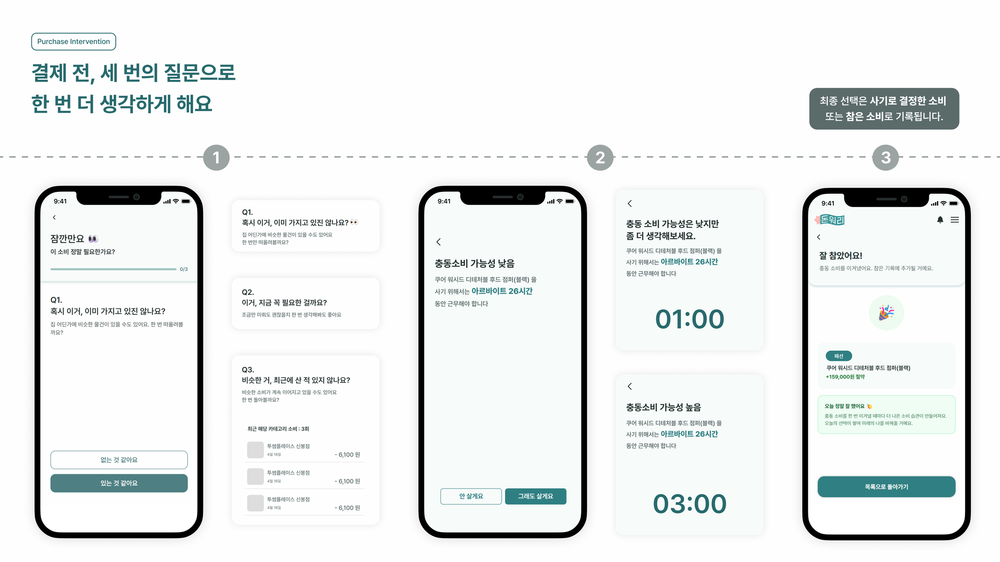

### 02 · 바로 사지 않고, 시간을 두고 다시 판단하기

사고 싶은 상품을 위시리스트에 담고 **1시간·1일·3일·7일** 중 고민 시간을 선택합니다. 시간이 지나면 구매·포기·연장을 다시 선택하고, 구매를 선택한 경우에는 개입 질문과 위험도 확인을 거칩니다.

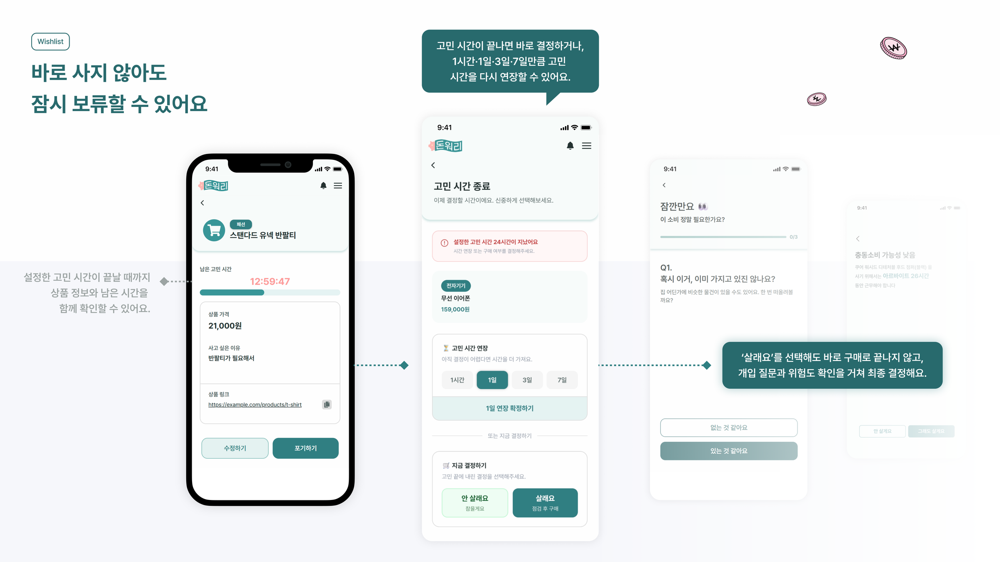

<details>
<summary>상품 등록 · 카테고리 · 위시리스트 목록 보기</summary>

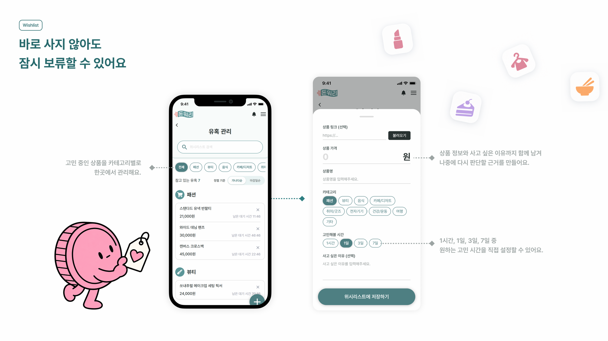

</details>

### 03 · 산 소비도, 참은 소비도 하나의 기록으로

구매한 소비와 참아낸 소비를 함께 기록합니다. 상품명·금액·카테고리·소비 이유를 남기고, 두 종류의 기록을 나누어 확인할 수 있습니다.

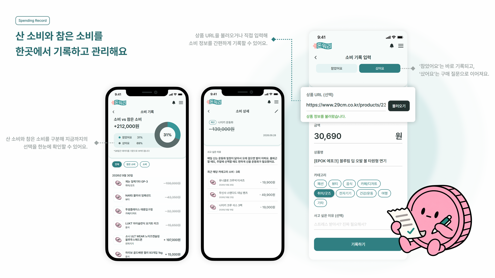

### 04 · 쓴 돈 너머, 나의 소비 습관 돌아보기

실제 지출과 참은 소비를 함께 살펴보고 절약 목표 달성률을 확인합니다. 카테고리별 소비, 취약 시간대, 유입 경로를 통해 반복되는 소비 패턴을 돌아봅니다.

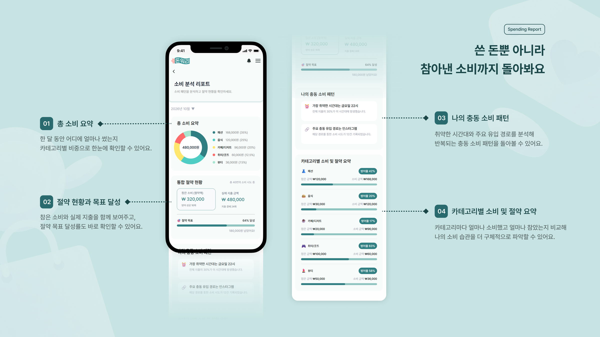

<details>
<summary><strong>더 둘러보기 · 온보딩 / 홈과 알림 / 마이페이지</strong></summary>

#### 나만의 소비 기준 설정

관심 카테고리와 절약 목표를 설정하며 서비스를 시작합니다.

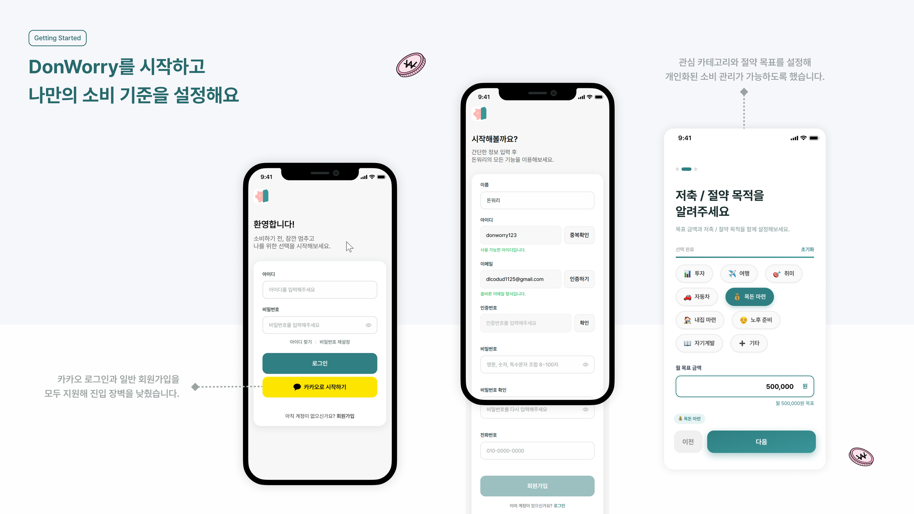

#### 오늘의 소비 상태 확인

홈에서 소비 요약과 목표 달성 현황을 확인하고, 알림에서 재판단이 필요한 상품 등을 살펴봅니다.

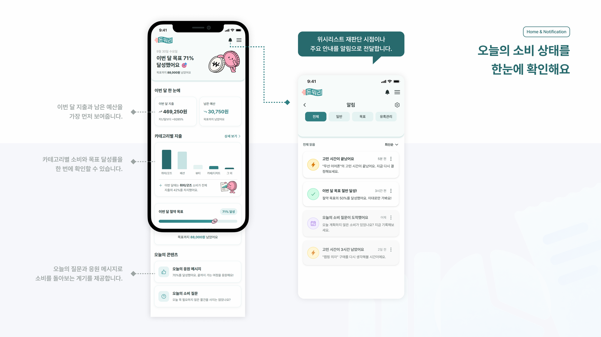

#### 목표와 예산 관리

마이페이지에서 프로필·예산·절약 목표·시급을 관리합니다.

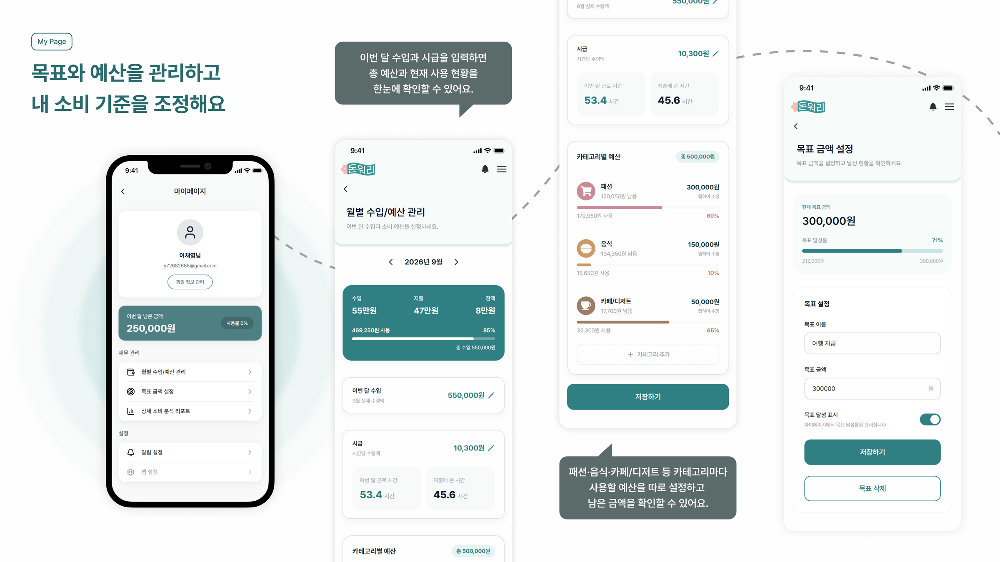

</details>

<br />

<a id="engineering"></a>

## 사용자 흐름을 지키는 프런트엔드 설계

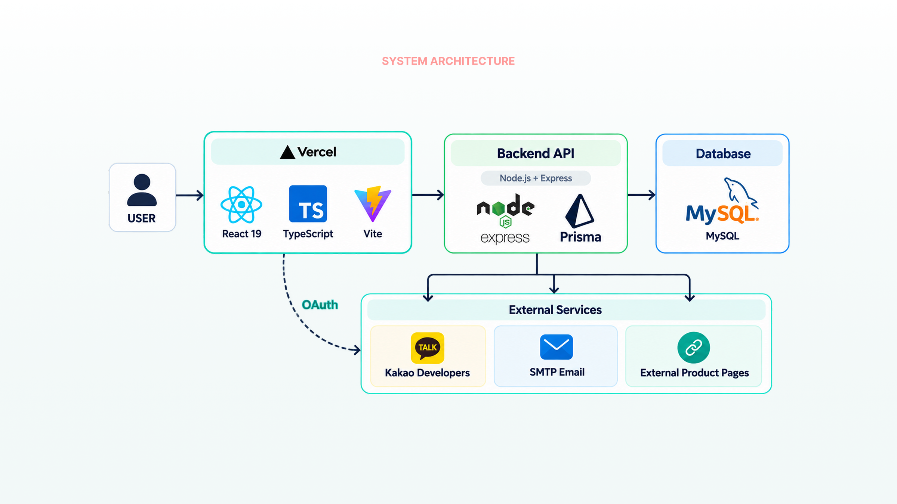

### 구현에서 집중한 부분

| 과제                                            | 구현 방식                                                               | 관련 코드                                                                             |
| :---------------------------------------------- | :---------------------------------------------------------------------- | :------------------------------------------------------------------------------------ |
| 여러 요청이 동시에 401을 받는 상황              | 진행 중인 토큰 갱신 요청을 공유하고, 일시적 통신 실패에는 세션을 유지   | [Axios 인터셉터](src/api/client.ts)                                                   |
| 인증 상태가 바뀌었을 때 화면 접근 제어          | 세션 구독으로 로그인 이동에 반영하고 원래 경로를 보존                   | [ProtectedRoute](src/shared/auth/ProtectedRoute.tsx)                                  |
| 고민 시간 연장 후 화면이 이전 상태를 읽는 문제  | 캐시를 먼저 갱신한 뒤 재조회하고, 결정이 끝난 상품은 목록에서 즉시 숨김 | [useWishlist](src/features/temptation/hooks/useWishlist.ts)                           |
| 위시리스트 화면 간 목록과 요청 상태 공유        | 하위 라우트를 Provider로 묶어 목록과 mutation 상태 공유                 | [WishlistProvider](src/features/temptation/hooks/WishlistProvider.tsx)                |
| 실패 요청을 불필요하게 반복하는 문제            | 공통 QueryClient에서 4xx 응답 재시도를 차단                             | [QueryClient](src/api/queryClient.ts)                                                 |
| 배포 후 이전 탭에서 청크를 불러오지 못하는 상황 | 없는 경로·청크 로드 실패·일반 오류를 구분해 복구 방법 안내              | [RouteErrorPage](src/pages/RouteErrorPage.tsx)                                        |
| API 명세와 프런트엔드 타입의 불일치             | OpenAPI 타입 생성과 CI 검사, 주간 명세 변경 검사                        | [CI](.github/workflows/ci.yml) · [OpenAPI Drift](.github/workflows/openapi-drift.yml) |

### 기술 스택

| 영역             | 사용 기술                                           |
| :--------------- | :-------------------------------------------------- |
| UI · 언어        | React 19 · TypeScript                               |
| 개발 · 빌드      | Vite                                                |
| 라우팅           | React Router 7                                      |
| 서버 상태 · 통신 | TanStack React Query 5 · Axios                      |
| 스타일           | CSS Modules · Tailwind CSS 4 테마 토큰 · Pretendard |
| 차트 · 모션      | Recharts · Framer Motion                            |
| 테스트           | Vitest · Testing Library · jsdom                    |
| 코드 품질        | ESLint · Prettier · Husky · lint-staged             |
| API 계약         | OpenAPI · @hey-api/openapi-ts                       |
| 배포 · 자동화    | Vercel · GitHub Actions                             |

<details>
<summary>디렉터리 구조 · 정보 구조(IA)</summary>

기능 전용 코드는 `features/<domain>`에 두고, 여러 기능에서 재사용하는 코드는 `shared`에서 관리합니다.

```text
src/
├── api/                 # 공통 Axios 클라이언트, 인증 API, 생성 타입
├── assets/              # 로고와 이미지
├── components/layout/   # 공통 레이아웃과 폼
├── constants/           # 카테고리와 시간 옵션
├── features/            # 도메인별 UI, hook, API, 타입
│   ├── auth/            # 인증
│   ├── home/            # 홈
│   ├── intervention/    # 구매 전 개입
│   ├── mypage/          # 프로필, 예산과 리포트
│   ├── notification/    # 알림
│   ├── onboarding/      # 초기 설정
│   ├── record/          # 소비와 참은 소비 기록
│   └── temptation/      # 위시리스트와 재판단
├── pages/               # 라우트 진입 페이지
├── router/              # 전체 라우트 정의
├── shared/              # 공통 인증, 컴포넌트와 유틸리티
└── test/                # 전역 테스트 설정
```

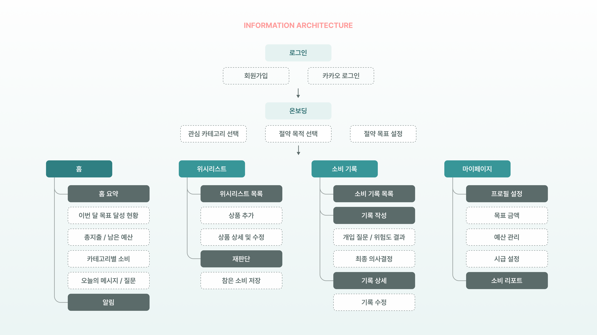

</details>

<br />

<a id="getting-started"></a>

## 로컬에서 실행하기

**Node.js 22.13 이상**과 npm을 사용합니다.

```bash
npm install
```

`.env.example`을 `.env.local`로 복사하고 아래 값을 채웁니다.

| 변수                      | 설명                                                                                         |
| :------------------------ | :------------------------------------------------------------------------------------------- |
| `VITE_API_BASE_URL`       | 백엔드 API 주소. 개발 프록시 대상이자 프로덕션 API baseURL                                   |
| `VITE_KAKAO_CLIENT_ID`    | 카카오 개발자 콘솔의 REST API 키                                                             |
| `VITE_KAKAO_REDIRECT_URI` | 카카오 콘솔에 등록한 Redirect URI. 로컬 기본값은 `http://localhost:5173/auth/kakao/callback` |

```bash
npm run dev
```

`.env.local`은 Git에서 제외됩니다. 개발 모드에서는 `/api` 요청을 Vite 프록시로 전달하므로 API 연동에 `VITE_API_BASE_URL`이 필요합니다. 이 값 없이 개발 서버 자체를 띄울 수는 있지만, **프로덕션 빌드는 값이 비어 있으면 실패**하도록 설정되어 있습니다.

<details>
<summary><strong>검증 명령 · 테스트와 커버리지</strong></summary>

```bash
npm test
npm run lint
npm run build
```

| 명령                    | 용도                                      |
| :---------------------- | :---------------------------------------- |
| `npm run test:watch`    | 테스트를 watch 모드로 실행                |
| `npm run test:coverage` | V8 커버리지 측정과 기준선 검사            |
| `npm run format:check`  | 소스 코드 포맷 검사                       |
| `npm run api:check`     | OpenAPI 스냅샷과 생성 타입 일치 여부 검사 |

테스트는 대상 코드 가까이에 두며, 공통 설정은 `src/test/setup.ts`에서 관리합니다. API 요청과 응답 변환, 비동기 상태, 인증·라우트 분기를 검증합니다.

커버리지 기준선은 `vitest.config.ts`의 `thresholds`에서 관리합니다. CI는 커버리지가 기준 아래로 떨어지면 실패하며, 테스트를 늘렸다면 기준선도 함께 검토합니다.

</details>

<details>
<summary><strong>배포 · 미리보기 환경</strong></summary>

GitHub Actions에서 Vercel CLI로 빌드하고 배포합니다.

| 트리거                     | 배포 환경  |
| :------------------------- | :--------- |
| `main` 브랜치 push         | Production |
| `develop` 브랜치 push      | Preview    |
| `main` / `develop` 대상 PR | Preview    |

PR에는 미리보기 URL이 댓글로 달리며, 같은 PR에 다시 push하면 댓글이 갱신됩니다. 포크 PR은 시크릿이 전달되지 않아 배포 대상에서 제외됩니다.

- 저장소 시크릿: `VERCEL_TOKEN`, `VERCEL_ORG_ID`, `VERCEL_PROJECT_ID`
- Vercel 환경 변수: `VITE_API_BASE_URL`, `VITE_KAKAO_CLIENT_ID`, `VITE_KAKAO_REDIRECT_URI`를 Preview / Production에 각각 등록

환경 변수는 `vercel pull`로 받아 빌드에 사용합니다. `vercel.json`의 rewrite는 `/temptation/3`처럼 중첩 경로로 직접 접근하거나 새로고침할 때 클라이언트 라우팅을 유지합니다.

</details>

<details>
<summary><strong>API 계약 동기화</strong></summary>

배포된 Swagger 명세를 갱신하고 TypeScript 타입을 생성합니다.

```bash
npm run api:sync
npm run api:generate
```

| 경로 / 명령            | 역할                               |
| :--------------------- | :--------------------------------- |
| `openapi/openapi.json` | 배포 API 명세 스냅샷               |
| `src/api/generated/`   | 자동 생성 타입. 직접 수정하지 않음 |
| `npm run api:check`    | 스냅샷과 생성 타입 일치 여부 검사  |
| `npm run api:drift`    | 배포 API와 저장된 스냅샷 차이 검사 |

PR CI는 생성 타입을 검사하고, 예약 워크플로는 매주 배포 API의 변경 여부를 확인합니다.

</details>

<details>
<summary><strong>협업 규칙 · Gitmoji와 Git Flow</strong></summary>

### Gitmoji

| Gitmoji | Type       | 설명                    |
| ------- | ---------- | ----------------------- |
| ✨      | `feat`     | 새로운 기능 추가        |
| 🐛      | `fix`      | 버그 수정               |
| 📦      | `chore`    | 패키지 추가 / 기타 작업 |
| ♻️      | `refactor` | 코드 리팩토링           |
| 🎨      | `style`    | UI / 스타일 수정        |
| 📝      | `docs`     | 문서 수정               |
| 🚑      | `hotfix`   | 긴급 버그 수정          |
| 🚀      | `perf`     | 성능 개선               |
| 💄      | `design`   | 디자인 개선             |
| 🔥      | `remove`   | 코드 삭제               |
| 🚚      | `move`     | 파일 이동 / 구조 변경   |
| 💡      | `comment`  | 코드 주석 추가          |
| ✅      | `test`     | 테스트 추가             |
| 🧪      | `test`     | 테스트 코드 수정        |
| 🔧      | `config`   | 설정 변경               |
| 🔨      | `build`    | 빌드 설정 수정          |
| 🚧      | `wip`      | 작업 진행 중            |
| 🎉      | `init`     | 프로젝트 초기화         |

### 커밋 메시지

```
깃모지 [타입]: [요약]

예) ✨ feat: 로그인 기능 추가
```

### 브랜치 전략

Git Flow — `main` / `develop` / `feature` / `release` / `hotfix`

```
feat/login-ui-#10
```

### PR 규칙

- 제목 형식: `깃모지 [타입(첫대문자)] [요약] (#이슈번호)`
  - 예) `✨ [Feat] 로그인 기능 추가 #10`
- 상호 코드 리뷰 필수
- PR 상세 설명 및 테스트 방법 필수 작성

### 태스크 관리

GitHub Projects — 각 태스크를 이슈로 관리, PR에서 `Closes #이슈번호`로 연결

</details>

<br />

## 구현을 돌아보며

**구매 전 질문 → 위험도 확인 → 최종 선택 → 기록과 리포트**를 하나의 소비 관리 흐름으로 연결했습니다. 위시리스트에서는 고민 시간 이후 다시 판단하도록 하고, 구매한 소비와 참은 소비를 모두 돌아볼 수 있게 했습니다.

다음 단계에서는 아래 항목을 확인하고 개선하려고 합니다.

- **사용자 검증** · 구매 전 개입과 재판단이 실제 충동소비 감소에 얼마나 도움이 되는지 확인
- **개인화** · 위험도 판단에 개인의 예산과 누적 소비 패턴을 더 충분히 반영
- **초기 사용 경험** · 기록이 적을 때도 리포트에서 유용한 안내를 제공할 방법 검토

<br />

<a id="team"></a>

## 함께 만든 사람들

SWUWEB 4th

<div align="center">

|                  이채영                  |                       문정윤                       |                  손예원                  |                      정유진                      |                 한지희                 |
| :--------------------------------------: | :------------------------------------------------: | :--------------------------------------: | :----------------------------------------------: | :------------------------------------: |
|              Team Lead · FE              |                         FE                         |                    FE                    |                        FE                        |                   FE                   |
| [@chae1125](https://github.com/chae1125) | [@moonjeongyuni](https://github.com/moonjeongyuni) | [@yewon426](https://github.com/yewon426) | [@yujining3827](https://github.com/yujining3827) | [@jiheeh0](https://github.com/jiheeh0) |

</div>

Back-end — 김민주 · 김이안 · 김예원 · 황은우

<div align="center">

<sub>사기 전 한 번 더, 참은 소비도 가치 있게. · DonWorry</sub>

[맨 위로 ↑](#top)

</div>
